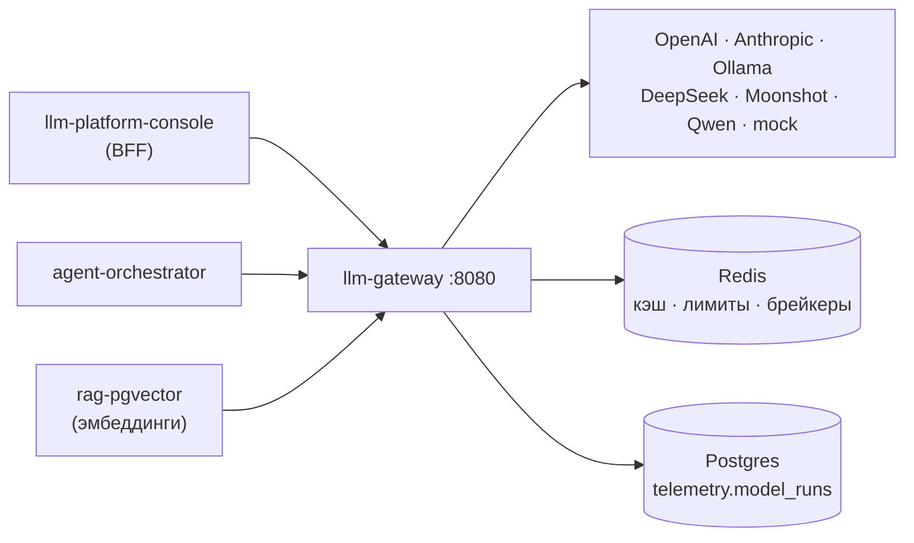
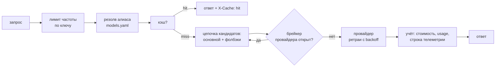

# llm-gateway

> Исходный код проекта закрыт — здесь его описание: архитектура, решения и результаты. Код покажу по запросу: Telegram [@interpol2121](https://t.me/interpol2121).

OpenAI-совместимый шлюз к LLM-провайдерам: OpenAI, Anthropic, Ollama и
OpenAI-совместимые облака (DeepSeek, Moonshot, Qwen) за одним `/v1` API.
Поверх этого — обратимое вырезание персональных данных до того, как их увидит
провайдер, декларативная маршрутизация с алиасами и цепочками фолбэков,
ретраи с full-jitter backoff, автоматические выключатели по провайдерам,
точный и семантический кэш, лимиты частоты и учёт стоимости по ключам,
долговременная телеметрия каждого вызова в Postgres и Prometheus-метрики.
Всё работает офлайн на детерминированном мок-провайдере — без единого ключа.

## Место в платформе



Шлюз — единственная дверь платформы к моделям: консоль показывает его каталог
и расход, оркестратор думает через него, rag векторизует через него — расход
виден в одном месте, ключи провайдеров не расползаются по сервисам.

## Запуск всей платформы

Вся платформа — четыре бэкенда, консоль, Postgres и Redis — поднимается одной
командой из соседнего репозитория
[llm-platform-console](https://github.com/INTERpol21/llm-platform-console),
который держит зонтичный `docker-compose.yml`. Пять репозиториев должны лежать
рядом в одной папке:

```bash
cd ../llm-platform-console
cp .env.example .env
docker compose up --build     # консоль на http://localhost:8080
```

Всё работает офлайн на мок-моделях без единого API-ключа; ключ авторизации по
умолчанию — `demo-key`. Главный план сборки, схема платформы и экскурсия — в
README консоли.

## Быстрый старт (этот сервис отдельно)

```bash
make install-dev
make run                          # uvicorn на :8080, авто-перезагрузка
# или: docker compose up --build  # плюс Redis для кэша и брейкеров

curl -s -H "Authorization: Bearer demo-key" -H "Content-Type: application/json" \
  -d '{"model":"mock-small","messages":[{"role":"user","content":"привет"}]}' \
  http://localhost:8080/v1/chat/completions
```

## API

`/v1` — клиентский API; вне версии два операционных маршрута: `/healthz`
(без ключа) и `/metrics` (с ключом). Всё остальное требует
`Authorization: Bearer <ключ>`.

| Эндпоинт | Что делает |
|---|---|
| `GET /healthz` | Живость и версия, без авторизации |
| `GET /metrics` | Prometheus-метрики: кэш, ретраи, брейкеры, gen_ai-гистограммы |
| `POST /v1/chat/completions` | Ответ модели; `stream: true` — SSE; `tools`, `response_format` и прочие параметры пробрасываются или запрос честно отклоняется |
| `POST /v1/embeddings` | Одна строка или батч; те же маршруты, фолбэки и учёт |
| `GET /v1/models` | Список в стиле OpenAI: алиасы + wildcard на провайдера |
| `GET /v1/models/catalog` | Богатый каталог: провайдер, статус, цены, окно контекста, фолбэки, `kind` (`chat` \| `embedding` — embedding-алиасы на чате дают 404, пикеру чат-моделей их надо отфильтровать) |
| `GET /v1/models/{id}/ping` | Проба алиаса с тем же ключом, что у настоящих вызовов, без траты токенов (GET списка моделей у провайдера): `ready`, `unauthorized` (провайдер ответил 401 — ключ отклонён, каждый вызов тоже получит отказ; `reachable` при этом `true`), `unreachable`, `not_configured`; и задержка. Статус в каталоге — только конфигурация: `ready` значит «ключ задан», а не «ключ принят» |
| `POST /v1/compare` | Один промпт на несколько моделей параллельно; каждая ячейка — обычный чат-вызов со своим ответом или ошибкой. `cache` в ячейке: `hit` (ответ из точного кэша — `cost_usd` 0, `latency_ms` — время поиска в кэше, `cost_saved_usd` — сколько стоил бы вызов), `miss`, `bypass`; `bypass_cache: true` в запросе — замер без кэша: каждая ячейка идёт к модели и оплачивается, кэш не читается и не пишется. `failed_attempts` / `fallback_reason` — как `X-Failed-Attempts` / `X-Fallback-Reason` у чата (ответ фолбэка в кэш не пишется); `upstream_timings` — разбивка Ollama у локальной ячейки: `latency_ms` считается от раздачи, и две локальные ячейки на одном демоне включают очередь друг за другом |
| `GET /v1/usage` | По ключу, в разбивке по запрошенным алиасам: запросы (все строки журнала — вызовы, кэш-хиты, отказы), КУПЛЕННЫЕ токены (без токенов кэш-хитов и без оценки стрима, умершего до первого токена), `cost_usd` и `cost_saved_usd` |
| `GET /v1/spend` | Расход из телеметрии по всему флоту, по интервалам, с кэшем: хиты, их токены и `cost_saved_usd` — сэкономленное, как его записал каждый хит (`cached_cost_usd` — устаревшая оценка по средней цене) |
| `GET /v1/spend/attribution` | Расход НАШЕГО ключа по функциям (заголовок `X-Attribution`): топ-`limit` меток, `other`, `unattributed`, `total` — см. [Расходы по функциям](#расходы-по-функциям-x-attribution) |
| `GET /v1/model-runs` | Телеметрия вызовов НАШЕГО ключа, новые первыми, keyset-пагинация; фильтры `model` (ЗАПРОШЕННЫЙ алиас), `status=ok\|error\|cancelled` (`cancelled` — клиент ушёл до ответа и вызов остановлен: не сбой), `cache=hit\|miss`, `attribution`, `since` (ISO 8601 **со смещением**; наивное время — 400), `request_id` — строки одного запроса, `served=other\|requested` (ответил ли не запрошенный алиас; строки фолбэка несут `failed_attempts` и `fallback_reason`); все — внутри обеих половин скоупа; одно чтение ограничено `TELEMETRY_READ_TIMEOUT_MS` (503 `telemetry_read_timeout`), недоступная БД — 503 `telemetry_unavailable`; у стрима `ttft_ms` — время до первого токена по часам шлюза (от входа в маршрут до первого чанка с текстом или вызовом инструмента); у вызова локальной модели `upstream_timings` — разбивка самой Ollama: загрузка модели (от прихода вызова в демон до готовой модели — около нуля, если она уже в памяти; включает ожидание, пока выгрузится другая модель), чтение промпта, генерация и полное время в демоне (остаток — ожидание слота модели) |
| `GET /v1/model-runs/{run_id}` | Одна строка журнала по id, со скоупом как у списка; `item: null`, если строки нет или она чужая (ответы неразличимы: id — не пропуск); `enabled: false` без БД |
| `GET /v1/config/pii` | Включена ли редакция, каким движком и покрыты ли ФИО |
| `PUT /v1/config/pii` | Включить или выключить без передеплоя (нужен админский ключ); с `REDIS_URL` значение сначала пишется в общий Redis, и если он его не принял — `503 pii_config_store_unavailable`, ничего не применено |
| `GET /v1/config/pii/stats` | Сколько сущностей убрано за неделю, в разбивке по типам |
| `GET /v1/config/changes` | Журнал изменений настроек (PII, mock-ручки, бюджеты): кто, когда, было → стало; курсорная пагинация, см. [Журнал изменений настроек](#журнал-изменений-настроек) |
| `GET /v1/budgets` | Бюджеты расходов: потрачено в текущем окне, состояние, сброс — только видимые НАШЕМУ ключу, см. [Бюджеты расходов](#бюджеты-расходов) |
| `GET /v1/config/budgets` | Определения бюджетов для редактора, в порядке хранения (нужен админский ключ) |
| `PUT /v1/config/budgets` | Заменить список бюджетов целиком, с проверкой ревизии (нужен админский ключ) |

Заголовки запроса сверх авторизации: `X-Request-ID` (свой id сквозной
трассировки, до 128 символов), `X-Attribution` (см.
[Расходы по функциям](#расходы-по-функциям-x-attribution)) и
`X-Semantic-Cache: allow` — разрешение отвечать на этот вызов из
семантического кэша (см. [Как это устроено](#как-это-устроено)).

Заголовки ответа: `X-Cache: hit|miss|semantic|bypass` (`bypass` — у стрима:
он не читает и не пишет ни один кэш), `X-Provider`, `X-Cost-USD`,
`X-Request-ID`, `X-PII-Redacted` (сколько сущностей вырезано),
`X-PII-Redacted-Types` (какие типы — `EMAIL,INN`…, только если что-то
вырезано; модель видела плейсхолдеры вроде `[INN_1]`, и её слова о формате
значения относятся к плейсхолдеру; у `/v1/compare` то же в теле:
`pii_redacted`, `pii_redacted_types`),
`X-Dropped-Params` (какие бухгалтерские параметры маршрут не смог унести),
`X-Semantic-Score` (на семантическом хите) и `X-Failed-Attempts` — сколько
попыток НЕ дали этот ответ: ретраи, упавшие кандидаты и пропущенные
(открытый брейкер, неподъёмные параметры, дедлайн); `0` — ответил основной
маршрут с первой попытки, на кэш-хитах заголовка нет. Какой алиас ответил на
самом деле — поле `model` в теле ответа и в каждом чанке стрима. Если ответил
фолбэк, `X-Fallback-Reason` говорит, почему не ответил запрошенный алиас, —
закрытый `kind` его последней попытки (`upstream_error`, `deadline`,
`circuit_open`, `params_unsupported`, `queue_timeout`); то же лежит в строке ledger'а
(`failed_attempts`, `fallback_reason`) и в ячейке `/v1/compare`, а
`/v1/model-runs?served=other&status=ok` отдаёт ровно ответы фолбэков. Счётчик
`llm_gateway_fallbacks_total{requested,served,reason}` — сигнал для алерта на
долю фолбэков; строки лога (ретраи, фолбэк, обрывы) несут `request_id`. В `502
all_attempts_failed` у каждой попытки есть закрытый `kind`:
`upstream_error`, `deadline`, `circuit_open`, `params_unsupported` или
`queue_timeout` — ветвиться по нему, а не по тексту `error`.
`X-Queue-Ms` — сколько миллисекунд вызов простоял в очереди за слотом
локальной модели, прежде чем уйти к демону (все ожидания цепочки вместе;
`0` — слот был свободен; нет заголовка — у маршрута нет лимита слотов, и на
кэш-хитах); то же в строке ledger'а (`queue_ms`) и в ячейке `/v1/compare`.
`X-Prompt-Truncated: true` — локальная модель прочитала промпт обрезанным
(её собственный счёт прочитанного сильно меньше оценки: ровно столько,
сколько оставляет обрезка длинного сообщения, или, у разговора около
`num_ctx`, сколько осталось после отброшенных старых сообщений); такой ответ
не кэшируется, у стрима флаг только в строке ledger'а (`prompt_truncated`), у
ячейки compare — поле `prompt_truncated`.

Контракт чата опубликован в OpenAPI целиком: тело `200`
(`ChatCompletionResponse`), кадр стрима (`ChatStreamFrame` — чанк или
конверт ошибки; стрим, упавший после заголовков, остаётся HTTP 200 и
заканчивается кадром ошибки, затем `data: [DONE]`), все заголовки выше и
единый конверт ошибки `ErrorEnvelope` на `400/401/404/413/429/500/502/503` —
консоль генерирует из него типы и не держит рукописных двойников. `429` —
это `rate_limit_exceeded` или `budget_exceeded` (исчерпан бюджет расходов:
`error.budget_id`, `period`, `resets_at` типизированы на `ErrorDetail`, плюс
заголовок `x-should-retry: false`; см. [Бюджеты расходов](#бюджеты-расходов)).
`400 context_length_exceeded` (`param: messages`) — промпт плюс место под
ответ не помещаются в контекст, с которым загружена локальная модель
(`num_ctx`): `error.estimated_prompt_tokens`, `max_tokens` и `num_ctx` говорят,
на сколько.
На `429` и ошибках провайдера шлюз отдаёт наружу `Retry-After` — самое раннее
время, которое предложил кто-то из цепочки, чтобы клиенту не приходилось
угадывать. `503 model_busy` (тип `service_unavailable`) — локальная модель
занята: все её слоты были заняты всё время, что запрос мог ждать, и никакая
настоящая модель на другом демоне не ответила (мок и модели того же демона за
занятую не отвечают никогда — см. «Очередь к локальной модели» ниже). Конверт
тот же, что у `502`: последняя попытка, которая могла ответить, — `queue_timeout`,
после неё — разве что пропуски по форме запроса (`context_length_exceeded`,
`params_unsupported`); если после занятой модели что-то упало иначе
(`upstream_error`, `deadline`, `circuit_open`), это `502`. Плюс `Retry-After: 5`
(подсказка, не обещание) и `X-Queue-Ms`. Вызывающий, который шлёт в одну
локальную модель несколько запросов разом (пакетная дооценка судьи в
оркестраторе, параллельные эмбеддинги rag), обязан это обрабатывать: ждать
`Retry-After` и повторять — или держать параллелизм не выше слотов модели
(`max_concurrency` провайдера, у владельца 1). Очередь в шлюзе ждёт не больше
10 с, а не всю 60-секундную попытку, как раньше очередь в демоне.

Чтения телеметрии (`/v1/model-runs`, `/v1/model-runs/{run_id}`, `/v1/spend`,
`/v1/spend/attribution`, `/v1/config/pii/stats`) при настроенном, но
недоступном Postgres отвечают `503` за секунды, а не `500` через 30 с:
`telemetry_unavailable` (нет соединения за 5 с или оно упало; без
`Retry-After` — когда вернётся база, шлюз не знает) или
`telemetry_read_timeout` (чтение не уложилось в свой statement timeout —
оконный агрегат в 5 с, страница или строка `/v1/model-runs` в
`TELEMETRY_READ_TIMEOUT_MS`; `Retry-After: 5`). Текст драйвера — хост, порт,
SQL — наружу не попадает. `/v1/usage` фолбэк-данные имеет и вместо 503
отвечает из реестра (с предупреждением в логе).

Фильтры `/v1/model-runs` — точные совпадения (`since` включительно, по
`created_at` — моменту записи строки, т.е. концу вызова), и каждый
повторяется в обеих половинах скоупа: ни `request_id`, ни метка не
открывают чужие строки. Пустая или содержащая NUL строка фильтра — `422`
`empty_<имя>` / `nul_in_<имя>`, а не «без фильтра»; `attribution`, которую
грамматика `X-Attribution` отвергла бы или переписала, — `422
invalid_attribution` (такой метки в журнале быть не может). Строковые
фильтры ограничены тем, что хранит запись: `request_id` и `attribution` —
128 символов, `model` — 200; длиннее — `400` с именем поля.

### Журнал изменений настроек

Три настройки меняются на лету: редакция PII (`PUT /v1/config/pii`), ручки
отказов mock-провайдеров (`PUT /v1/config/mock`) и бюджеты (`PUT
/v1/config/budgets`). Каждое изменение записывается ДО того, как вступает в
силу: было → стало, дайджест ключа, `X-Request-ID` запроса. С
`TELEMETRY_DATABASE_URL` журнал — таблица `telemetry.gateway_config_changes`, без
неё — кольцо на 500 записей в памяти процесса (`durable: false`, после рестарта
пусто).

- **Нет записи — нет изменения.** Если журнал не принял строку за
  `GATEWAY_CONFIG_AUDIT_TIMEOUT_SECONDS`, `PUT` отвечает `503
  config_audit_unavailable` («The configuration change log is unavailable;
  nothing was changed.») и ничего не меняет. Исключение одно — ВКЛЮЧЕНИЕ
  редакции PII: это защита живого трафика, и падение Postgres не должно её
  блокировать. Она включается, в логе остаётся ERROR с `request_id`, ответ
  несёт `"audit": "unrecorded"`. У бюджетов строки журнала пишутся внутри
  транзакции самих бюджетов: либо обе записи, либо ни одной.
- **Холостой `PUT` ничего не пишет.** Тот же `PUT` повторно — ни строки, ни
  события, `"audit": "noop"`. Но отставшая реплика всё равно подтягивает себе
  значение флота, и общий флаг в Redis всё равно пишется.
- **`GET /v1/config/changes`** — новые первыми, `limit` 1–100 (по умолчанию 10),
  `cursor` — `next_cursor` прошлой страницы, `setting` — одно из `pii_redaction`,
  `mock_knobs`, `budgets`. Читать может любой ключ, без лимита запросов. У
  каждой строки `by_caller`; 8 hex дайджеста (`actor_digest_prefix`) — только на
  строках СВОЕГО ключа, чужие строки не называют ключ никак. Строки `budgets`
  видит только админский ключ: в них дайджесты чужих ключей и метки команд.
  Недоступная БД (нет соединения или сработал statement timeout чтения) —
  `503 config_audit_unavailable` с той же константой, как у rag и
  оркестратора: у эндпоинта один контракт ошибки на все три сервиса. Ошибка
  самого запроса — `500`.
- **Событие `config_changed`** уходит в `platform:events` после каждого
  записанного изменения: `{type, service: "gateway", setting, request_id}` —
  без значений, без цели и без ключа. Открытые консоли по нему перечитывают
  настройку и историю.
- **Метрика** `llm_gateway_config_changes_total{setting, outcome}`: `recorded`
  (строки), `noop`, `audit_unavailable`, `applied_unrecorded`, `store_refused`.

Рестарт, синхронизация реплик через Redis и опрос бюджетов — не действия
оператора, строк не пишут. Поэтому последняя строка может быть старше рестарта,
сбросившего mock-ручки к `models.yaml`; живое значение всегда показывает сама
настройка. С несколькими репликами одинаковые `PUT` на разные реплики в одну
миллисекунду могут записать переход дважды: лок — на процесс.

### Бюджеты расходов

Журнал `telemetry.model_runs` говорит, сколько потрачено; бюджет превращает это
в контроль. Бюджет — лимит в USD (не меньше `$0.01`) на **календарные UTC-сутки
или UTC-месяц** (00:00 UTC = 06:00 по Омску) для одной области:

| `scope` | `match` | Что считается |
|---|---|---|
| `global` | нет поля | весь трафик |
| `key` | 16 hex — `key_digest` ключа, никогда сам ключ | вызовы одного API-ключа |
| `model` | алиас | ЗАПРОШЕННЫЙ алиас (`model_runs.model`), а не тот, что ответил после фолбэка |
| `attribution` | метка `X-Attribution` (та же грамматика) | вызовы с этой меткой |

Поля: `id` (слаг `^[a-z0-9][a-z0-9_-]{0,47}$`), `period` (`day` \| `month`),
`limit_usd`, `warn_pct` (1–99, по умолчанию 80), `enforce` (по умолчанию
`true`; `false` — бюджет только оповещает и никогда не отказывает). Не больше 50
бюджетов. В OpenAPI `BudgetDef` — дискриминированное объединение по `scope`, у
каждого варианта свой паттерн `match`; лишнее поле — `400`.

- **`GET /v1/budgets`** — любой ключ: для каждого видимого бюджета `spent_usd`,
  `used_pct` (может быть больше 100), `state` (`ok` / `warn` / `exhausted` /
  `unknown`), начало окна и `resets_at`, `ledger_spent_usd` (сумма журнала за
  окно) и `counter_behind_ledger`. Админский ключ видит все бюджеты; любой
  другой — `global`, `model` и `key`-бюджеты на СВОЙ дайджест, но никогда чужой
  ключ и никогда `attribution` (метки могут называть команды). В отчёте ещё
  `counters` (`redis` / `memory` / `unavailable`), `persistent` (переживут ли
  определения рестарт) и `alerts_delivery` (`live`, когда события уходят в
  Redis-шину).
- **`GET` / `PUT /v1/config/budgets`** — только админский ключ (в определениях
  чужие дайджесты и метки). `PUT` — замена списка целиком; тело `GET` без правок
  годится как тело `PUT`. `expected_revision` включает сравнение ревизии:
  расхождение — `409 budget_revision_conflict`, ничего не записано. Тот же
  список — no-op (без бампа ревизии, аудита и оповещений). Исключение — битый
  сохранённый документ (ручная правка): с ним реплика не стартует, `PUT`
  читает его как пустой список и ВСЕГДА перезаписывает, даже пустым списком, —
  так через API чинится то, что не даёт загрузиться. Повтор `id` —
  `422 duplicate_budget_id`, новый или перенацеленный `model`-бюджет на алиас,
  которого нет в маршрутах, — `422 unknown_budget_model`; оба называют строку
  (`index`, `param: "budgets[i]..."`). Сохранённый бюджет, чей алиас потом ушёл
  из `models.yaml`, сохраняется дальше и помечен (`unroutable` в конфиге,
  `routable: false` в отчёте). Запись в Postgres ограничена
  `BUDGET_STORE_TIMEOUT_SECONDS`: сбой или зависание — `503
  budget_store_unavailable`, локально ничего не применено. Каждое изменение —
  аудит-строка после коммита (замаскированный ключ, `request_id`, id бюджетов)
  и по строке журнала изменений на каждый добавленный, удалённый или изменённый
  бюджет — в той же транзакции, что и сама запись (см.
  [Журнал изменений настроек](#журнал-изменений-настроек)).

**Отказ.** Исчерпанный бюджет с `enforce: true` отклоняет вызов в своей области
ДО кэшей, редакции и провайдера: чат (стрим и нет), эмбеддинги и каждая ячейка
`/v1/compare` по отдельности. Кэш-хит под исчерпанным бюджетом тоже отклоняется.

```http
HTTP/1.1 429 Too Many Requests
Retry-After: 7200
x-should-retry: false

{"error": {"message": "Budget 'demo-team' (day) is exhausted; calls are refused until 2026-09-25T00:00:00+00:00.",
           "type": "insufficient_quota", "code": "budget_exceeded",
           "budget_id": "demo-team", "period": "day", "resets_at": "2026-09-25T00:00:00+00:00"}}
```

`Retry-After` — секунды до сброса окна; `x-should-retry: false` останавливает
автоматические ретраи SDK OpenAI (они игнорируют `Retry-After` больше 60 с и
удвоили бы каждый отказ). Отказанный стрим — обычный JSON `429`, не
`text/event-stream`. Ячейка compare — `ok: false`, `error: "budget exceeded:
<id>"`, `error_code: "budget_exceeded"`, соседние модели отвечают. Отказ пишет
строку журнала `status: "error"`, `error: "budget_exceeded: <id>"`, $0, с
дайджестом ключа и меткой вызывающего; в gen_ai-гистограммы не попадает.

**Мягкий потолок.** Проверка перед вызовом каждый раз читает СВЕЖИЕ счётчики,
а списание — после вызова, поэтому перерасход ограничен: вызовы, пропущенные до
списания, пересёкшего лимит, и ещё не завершённые, × максимальная цена одного
вызова. Резервирование до вызова потребовало бы оценки цены и возврата на
каждой ветке отказа.

**Счётчики и журнал.** Траты считаются в Redis целыми единицами 1e-8 USD
(`INCRBY`, TTL — конец окна плюс сутки), без Redis — в памяти процесса
(каждая запись вычищает истёкшие окна, поэтому и там рост ограничен).
Недоступны счётчики — вызов пропускается (fail-open) и растёт
`llm_gateway_budget_unmetered_total{op}`; в отчёте тогда `state: "unknown"` и
`spent_usd: null`. Журнал главнее счётчика: новый бюджет засевается суммой
журнала за текущее окно, а раз в минуту односторонняя сверка (с Postgres, одна
реплика флота на интервал) поднимает счётчик, отставший от «устоявшегося»
журнала (строки старше 60 с). Счётчик никогда не опускается: опережение
журнала — нормальное (строка журнала пишется асинхронно) и безопасное
направление. Без Postgres сверки нет: списание, потерянное при отмене ячейки
compare по страховочному `wait_for`, так и останется недосчётом.

**Оповещения.** Пересечение порога `warn_pct` или 100 % публикует в
`platform:events` ровно одно событие на бюджет, окно, уровень и значение
порога — при списании, после `PUT` (лимит опустили ниже трат; новый бюджет
засеян выше порога) и при сверке. Поднятый лимит — новый порог и новое
оповещение; возврат к прежнему лимиту в том же окне повторно не оповещает.
Поля события (единственное место, где этот словарь описан):

| Поле | Значение |
|---|---|
| `type` | `budget_alert` |
| `budget_id` | id бюджета |
| `scope` | `global` \| `key` \| `model` \| `attribution` |
| `period` | `day` \| `month` |
| `level` | `warn` \| `exhausted` |
| `threshold_pct` | `warn_pct` для `warn`, `100` для `exhausted` |
| `enforce` | `true` — бюджет отклоняет вызовы, `false` — только оповещает |
| `resets_at` | конец окна, ISO 8601 UTC |

Ни `match`, ни сумм: шина видна любому, кто может открыть `/v1/events`
оркестратора (так же, как `model_run` с его `api_key_digest` и `cost_usd`), —
это свойство шины, не новое. Развёртыванию, которому нужна изоляция
арендаторов, `/v1/events` недоверенным ключам отдавать нельзя.

**Бюджеты по меткам — кооперативный учёт, не граница.** Метку ставит
вызывающий: можно не поставить её и обойти бюджет или тратить под чужой меткой
и исчерпать чужой бюджет. Для принуждения — области `key` или `model`. Бюджет
`global` или `key` останавливает и ингест rag (эмбеддинги платные): чтобы
защитить дорогую чат-модель, не трогая `mock-embedding`, — бюджет `model`.

**Рост журнала.** Каждый отказ — строка журнала; их ограничивает только
лимит ключа (`RATE_LIMIT_RPM × 1440` строк в сутки на ключ). Ретеншен по
умолчанию выключен: для точных месячных окон (засев, сверка,
`ledger_spent_usd`) включайте `GATEWAY_RETENTION_MODEL_RUNS_DAYS` не меньше
32 дней.

Метрики: `llm_gateway_budget_refusals_total{scope}`,
`llm_gateway_budget_alerts_total{level}`,
`llm_gateway_budget_unmetered_total{op}`,
`llm_gateway_budget_reconciled_total` — без id бюджетов в лейблах.

## Как это устроено



- `models.yaml` объявляет провайдеров и алиасы с ценами, окнами контекста и
  фолбэками; запрос вида `"<provider>/<model>"` — сквозной wildcard без
  правки конфига. Неизвестная модель — честный 404 до всякой работы.
- **Размер контекста локальной модели — в конфиге, а не в окружении демона.**
  `num_ctx` у Ollama-маршрута уходит как `options.num_ctx` в каждом запросе к
  модели (и через wildcard `ollama/<model>`): без него демон грузит модель с
  дефолтом (4096 на 24 GB Mac) и молча отрезает начало длинного промпта вместе
  с системным. Это не `context_window` (максимум модели для каталога и учёта):
  `num_ctx` ≤ `context_window`, одно значение на модель — иначе демон
  перезагружал бы её между запросами. У `qwen2.5` — 12288, у `llama3.2` —
  8192 (E7: бюджет промпта оркестратора 6000 оценочных токенов плюс ответ
  1024 помещается в оба; уменьшать размер можно было только вместе с
  предпроверкой ниже — длиннее промпт теперь 400, а не обрезка).
  Там же `keep_alive` — сколько демон держит модель после её последнего
  запроса (верхний уровень тела `/api/chat` и `/api/embed`, на каждом
  запросе): у `qwen2.5` и `bge-m3` 30 минут, у `llama3.2` 10 (замер E7: 10%
  холодных загрузок за день — модель, простоявшая дольше дефолтных 5 минут,
  ~4.8 с следующему прогону). Только положительное целое `s`/`m`/`h`:
  `-1` (держать вечно) не даёт загрузиться следующей модели, `0` выгружает
  после каждого вызова.
- **Промпт длиннее контекста локальной модели — 400, а не молчаливая
  обрезка.** Ollama 0.34.4 отвечает на промпт длиннее `num_ctx` кодом 200 и
  ничем не показывает, что прочла меньше. Разговор она сначала укорачивает,
  отбрасывая целые старые сообщения с начала (system-сообщения и последнее
  остаются), пока остаток не влезет; то, что не влезает и так (одно длинное
  сообщение), режется до первых 4 токенов и хвоста — `num_ctx / 2 + 2`
  токенов, системный промпт пропадает первым (8194 токена у промпта за 16384
  в прогоне на реальных моделях, 4098 у llama3.2 с 8192 — сколько бы промпт
  ни превышал контекст). Шлюз оценивает промпт без токенайзера, по семейству
  токенайзера модели: у `llama3*` и `llama-3*` — Llama 3, у всех остальных
  (qwen2.5 и любая модель через wildcard) — qwen2.5. Цена — по кускам текста:
  серия пробелов и латинское слово (camelCase делится) — фиксированная доля
  токена, символ любой другой письменности — своя цена у каждого семейства,
  пунктуация и разметка — по символу. Семейства расходятся в цифрах (qwen2.5
  тратит токен на каждую цифру, Llama 3 — на группу до трёх) и сильнее всего
  в прочих письменностях: греческая буква — 0.9 токена у qwen2.5 и 0.3 у
  llama3.2, еврейская — 0.3 и 1.05, грузинская — 1.05 и 2.05. Одна цена на
  все письменности не годится: по цене пунктуации (0.8 за символ) арабский и
  греческий текст выходил в 2.2× счёта llama3.2 и получал 400 на 47%
  контекста, а грузинский и армянский — в 0.4–0.5× её счёта, т.е. уходил к
  демону длиннее `num_ctx`. Веса подогнаны под счёт самих моделей
  (`prompt_eval_count`, Ollama 0.34.4). На 21 тексте платформы (русская и
  английская проза, таблицы, код, YAML, JSON, логи, строки с числами, CJK) —
  0.88–1.11 от счёта qwen2.5 и 0.87–1.14 от счёта llama3.2, на 8 отложенных
  текстах (TypeScript, CSS, changelog, промпты оркестратора…) — 0.96–1.10 у
  обеих. Цены 12 письменностей (арабская, греческая, иврит, деванагари,
  тайская, армянская, грузинская, бенгальская, тамильская, эфиопская,
  кхмерская, хангыль) подогнаны на одном тексте каждая и проверены на втором:
  0.75–1.25 (шире всего — одна арабская письменность у двух языков: арабский
  1.23–1.25 от счёта qwen2.5, персидский 0.75–0.81). Латиница с диакритикой
  считается как при подгонке (французский, немецкий, турецкий — 0.94–1.18,
  польский — 0.76–0.81), кроме вьетнамских букв, которые входят в слово
  (1.13–1.27, было 1.9×). Письменность без своей цены — 1.4 токена за символ
  у qwen2.5 и 2.0 у llama3.2 (по плохо покрытым письменностям; гуджарати,
  телугу, малаялам, сингальский и бирманский выходят в 0.85–1.16). Цена
  письменности покрывает только те её блоки, на которых её мерили: прочие
  словарь склеивает хуже, вплоть до токена на байт UTF-8. Поэтому отдельно
  замерены (живые тексты и прогоны всех букв блока подряд): позиционные формы
  арабских букв, которые pypdf отдаёт для многих арабских и персидских PDF
  (1.3–1.7 токена за символ против 0.25–0.4 у обычных букв), разложенный (NFD)
  корейский — 1.2 и 2.9 токена за чамо против 0.5–0.6 за слог, полноширинные
  и полуширинные формы; по цене письменности такой промпт длиннее `num_ctx`
  оценивался в 0.2–0.4 своего счёта, уходил к демону и резался молча, с
  кэшированием испорченного ответа. Теперь — 1.02–1.15 на живых текстах.
  Остальные блоки оценённых письменностей (CJK Extension A и
  совместимые иероглифы, совместимые и архаичные чамо, политоническая
  греческая, арабские Supplement и Extended-A, лигатуры и формы огласовок,
  грузинские мтаврули и Supplement, эфиопский Extended, кхмерские символы,
  полуширинный хангыль) стоят по верхней границе — 3 токена за символ (длина
  UTF-8; замеры прогонов — 1.48–2.84): текст почти целиком из них получает
  400 раньше (до 1.9× счёта qwen2.5), но не режется. Не мерились: эмодзи,
  base64, длинные повторы одного символа (`=====`, псевдографика), редкие
  символы внутри оценённого блока (иероглифы классического китайского).
  Длинный промпт из прогона на реальных моделях (английские
  строки с числами) — 1.06× у qwen2.5 и 1.07× у llama3.2; одна таблица на обе
  модели, подогнанная под qwen2.5, давала на нём 1.49× у llama3.2 и
  отказывала промптам, которые помещаются. Формула E7 (кириллица / 2.3,
  прочее / 3.4) вдвое-втрое недосчитывает цифры, разметку и CJK. На текстах
  платформы оценка выше настоящего счёта не больше чем на 11% у qwen2.5 и на
  14% у llama3.2 (худшие замеры): такой промпт с ответом проходит до ~11 тыс.
  настоящих токенов у qwen2.5 (12288 / 1.11) и до ~7.2 тыс. у llama3.2
  (8192 / 1.14). На других письменностях запас другой (по всем живым текстам
  оценка — 0.75–1.27 от счёта модели): ближе к границе запрос может получить 400,
  хотя модель прочла бы его целиком, или уйти длиннее `num_ctx` — тогда его
  ловит сверка после ответа. Кто сам бюджетирует промпт под локальную модель
  (оркестратор — 6000 токенов по формуле E7), пусть считает этим же
  оценщиком (`estimate_text_tokens` в `app/services/context_fit.py`, с
  `token_weights` маршрута) или оставляет запас: промпт с таблицей цифр или
  CJK, «6000» по E7, на деле длиннее и может не влезть в 8192 llama3.2 — это
  400 или пропуск фолбэка; число шлюза — в `error.estimated_prompt_tokens`.
  Оценка плюс место под ответ (`max_tokens` под потолком маршрута; без него —
  один токен) больше `num_ctx` — запрошенная модель отвечает `400
  context_length_exceeded`, фолбэк пропускается (`kind:
  context_length_exceeded` — например, llama3.2 с 8192 за qwen2.5 с 12288).
  Запрос без `max_tokens` получает не больше места, которое оставляет промпт,
  чтобы демону не пришлось сдвигать контекст посреди ответа. После ответа —
  сверка по счёту самой модели, для каждого из двух способов укоротить промпт
  своя: модель прочитала ровно столько, сколько оставляет обрезка
  (`num_ctx / 2 + 2`, ±16 токенов), а оценка выше этого и на треть выше
  прочитанного; или это разговор (до последнего сообщения есть не-system),
  оценка которого не меньше 3/4 `num_ctx` (только такой может на деле
  превысить контекст — худший замеренный недосчёт 0.75) и на треть выше
  прочитанного (целый промпт читается не меньше чем на 1/1.27 оценки). Тогда
  ответ помечается `X-Prompt-Truncated: true`, флагом `prompt_truncated` в
  ledger'е и не кэшируется (счётчик
  `llm_gateway_prompt_truncations_total{provider}` должен стоять на нуле).
  Небольшой отброс от ошибки оценщика не отличить — такой ответ не
  помечается: от четверти промпта при точной оценке до почти половины при
  худшем замеренном недосчёте (помечается отброс больше 1 − 3u/4 промпта, где
  u — доля настоящего счёта, которую дала оценка). Обрезка — именно «ровно»: «не больше половины контекста»
  верно и для любого целого промпта короче, и такой промпт, прочитанный
  целиком, ложно помечался.
- **Очередь к локальной модели — в шлюзе, а не в демоне.** Ollama выполняет
  запросы к одной модели по `OLLAMA_NUM_PARALLEL` штук (у владельца — 1), а
  остальные ставит в свою очередь, которой шлюз не видит: ожидание съедало
  60-секундную попытку, короткий шаг research за длинной генерацией падал по
  таймауту через 60.04 с (на свободном демоне — 0.23 с), и отвечал
  mock-small. Теперь `max_concurrency` у провайдера в `models.yaml` (= тот
  самый `NUM_PARALLEL`) даёт столько слотов на КАЖДУЮ загруженную модель
  (алиас, wildcard и фолбэк-хоп к одной модели делят её слоты); вызов берёт
  слот до отправки и отдаёт, когда ответ готов (стрим — когда кончился), —
  таймер попытки меряет модель, а не очередь к ней. Не к демону: слоты — на
  модель, и два вызова к РАЗНЫМ чат-моделям одного демона (Compare qwen2.5 и
  llama3.2 — его ячейки идут параллельно; судья на llama3.2 во время research
  на qwen2.5) оба уходят в демон, а когда обеим моделям не хватает памяти
  (медиана, см. ниже), второй ждёт внутри демона ответа первой и свопа — в
  своей попытке, `X-Queue-Ms` этого не видит (видит `upstream_timings` в
  строке ledger'а: `total_ms` минус фазы). Потолок ответа (2048) это ожидание ограничивает; общий слот на
  все чат-модели одного демона — возможный следующий шаг. Ждать слот можно,
  пока в
  дедлайне запроса остаётся целая попытка: 70 − 60 = 10 с на входе в роут,
  у ретрая или фолбэк-хопа обычно ноль (только свободный слот). Не дождался —
  попытка `queue_timeout`, брейкер не кормится (занятая модель исправна), и
  цепочка пропускает мок (он замещает модель, которая не может ответить, а не
  занятую) и ЛЮБУЮ модель того же демона, в том числе соседку по
  `LOCAL_FALLBACK_POLICY=local` (qwen2.5 ↔ llama3.2). Свободный слот соседки в
  шлюзе не значит свободного места в демоне: при обычной свободной памяти
  (медиана 3.6 GiB, а llama3.2 на поставляемых 8192 рядом с qwen2.5 нужно
  ~4.0 GiB) демон может
  загрузить её, только вытеснив занятую модель, а вытеснит, когда та договорит
  (до ~70 с на ответ в 2048 токенов у qwen2.5). Это та самая невидимая очередь
  в демоне: она съедает попытку фолбэка и дедлайн (обрыв по дедлайну или
  поздний ответ при `X-Queue-Ms` в 10 с), а qwen2.5 после неё выгружена, и
  следующий вызов к ней платит холодную загрузку. Модель на ДРУГОМ демоне
  (другой провайдер) и облачный маршрут пробуются; иначе — `503 model_busy` с
  `Retry-After: 5`: клиент получит запрошенную модель через несколько секунд, а
  не более слабую через минуту. Упавшую (не занятую) модель соседка
  по-прежнему заменяет. Значит, вызывающий, который шлёт одной локальной
  модели несколько вызовов разом, теперь получает 503 через ~10 с там, где
  раньше ждал в демоне (до конца своей 60-секундной попытки): бэкфилл судьи
  оркестратора (5 вызовов сразу по 2–6 с) и параллельные прогоны research
  должны повторять `model_busy` по `Retry-After` в пределах своего бюджета или
  не слать модели больше вызовов, чем у неё слотов. Лестница таймаутов не
  меняется:
  очередь живёт внутри 70-секундного дедлайна. Поиск в семантическом кэше
  (вопрос эмбеддится через те же слоты) слота не ждёт: занятый эмбеддер —
  пропуск поиска (info-строка в логе), а не трата ожидания самого чата, и не
  тайм-аут очереди — в счётчик ниже он не попадает. Слоты — в памяти процесса:
  при N репликах перед одним демоном до N × `max_concurrency` одновременных
  вызовов. Счётчик `llm_gateway_queue_timeouts_total{provider}` — сигнал
  «демон насыщен».
- **Потолок ответа локальной модели — `max_output_tokens`.** Демон обслуживает
  модель по одному запросу, и стрим держал этот слот, пока модель говорила
  (Chat Lab разрешал 32768 токенов), а все остальные ждали. Цепочка
  применяет потолок к КАЖДОМУ кандидату отдельно: больший `max_tokens`
  понижается до него, запрос без `max_tokens` получает его, меньший остаётся
  как есть; фолбэк несёт свой потолок (у mock-small его нет — он получает то,
  что просил клиент). Обрезанный ответ говорит об этом `finish_reason:
  "length"`. У `llama3.2` и `qwen2.5` — 2048 (вдвое больше самого длинного шага
  оркестратора и примерно одна попытка времени слота, см. `models.yaml`).
  Целиком в одну 60-секундную попытку такой ответ qwen2.5 влезает только
  стримом (29–36 ток/с — 57–70 с генерации): НЕстримовый вызов, дошедший до
  потолка, обрывается таймаутом попытки, а не заканчивается `finish_reason:
  "length"`. Нестримовые шаги оркестратора держатся на том, что ответы короткие
  (самый длинный замеренный — 593 токена), пока он не шлёт свои `max_tokens`
  (P37: plan и reflect 256, судья 384, synthesize и раунд агента 1024).
  Потолок и `num_ctx` отдаёт каталог (`/v1/models/catalog`): это верхняя
  граница, которую стоит предлагать ручке `max_tokens`.
- **Локальные эмбеддинги — `bge-m3` на Ollama, без фолбэка.** Маршрут
  `kind: embedding` (1024 измерения, мультиязычный, без цены) — то, через что
  rag строит корпус по ADR-0018
  консоли. Фолбэка нет сознательно: чат-фолбэк всё равно отвечает на вопрос, а
  эмбеддинг-фолбэк отвечает в ДРУГОМ векторном пространстве (`mock-embedding` —
  256 измерений и не семантический), поэтому лежащий демон или не скачанная
  модель — это 502, а не мок-вектор. `num_ctx` = 8192, весь максимум модели:
  у энкодера нет KV-кэша, и 8192 стоит столько же памяти, сколько 2048
  (673 MB, замер на Ollama 0.34.4). Но входной предел задаёт не он: демон
  0.34.4 молча режет вход эмбеддинга по размеру батча, 2048 токенов по
  умолчанию (~8000 символов русского текста); чанки rag по 800 символов — ~200.
  Ответ демона, где векторов не столько, сколько входов, — тоже 502: индексы
  строятся по позиции, и короткий батч сдвинул бы векторы на чужие тексты.
  То же правило у `text-embedding-3-small`: его фолбэк на `mock-embedding`
  снят — без ключа или при сбое OpenAI он отвечал 200 векторами из другого
  пространства. Ни один поставляемый embedding-маршрут не падает в другую
  модель (tests/test_local_embedding_route.py).
  Во что падают сами `llama3.2` и `qwen2.5`, выбирает `LOCAL_FALLBACK_POLICY`:
  по умолчанию — объявленный `mock-small` (демо и CI), в режиме `local` — друг
  в друга (`local_fallbacks`; мок там валидация конфига не пропустит), в
  `none` — никуда (честный 502). Фолбэк в другую локальную — чаще всего своп:
  холодная загрузка (медиана 3.3 с у qwen2.5, 1.8 с у llama3.2 на M4 Pro) и,
  возможно, вытеснение основной модели. Соседка заменяет модель, которая
  упала, а не занятую: не дождавшаяся слота модель — `503 model_busy` (см.
  «Очередь к локальной модели»).
- **Сколько локальных моделей держится в памяти — не константа.** Ollama на
  macOS пускает модель по СВОБОДНОЙ СИСТЕМНОЙ памяти в момент загрузки (в
  логе демона `system_limited=true`), а не по ~17.8 GiB памяти Metal, которые он
  показывает: модель загружается рядом с уже загруженными, только если
  свободно примерно на 1 GiB больше её предсказанного размера, иначе демон
  сначала вытесняет другую. Замер на M4 Pro 24 GB владельца (Ollama 0.34.4,
  KV q8_0, flash attention, 16384; L42 прогона на реальных моделях, 225
  решений о загрузке): предсказанные размеры qwen2.5 5.2 GiB, llama3.2
  3.6 GiB, bge-m3 1.1 GiB; llama3.2 вставала рядом при ≥ 4.5 GiB свободной
  памяти и вытесняла при ≤ 4.4 (на поставляемых 8192 ей нужно примерно на
  0.5 GiB меньше — ~4.0 GiB, по логу это 19% решений о загрузке вместо 9%),
  qwen2.5 встала рядом один раз — при 6.6 GiB, bge-m3 — всегда (2.1–6.4 GiB).
  Медиана свободной памяти в момент загрузки — 3.6 GiB, поэтому обычно в
  памяти одна чат-модель и bge-m3, обе чат-модели — исключение, и всё зависит
  от прочих программ на Mac и порядка загрузки. Своп стоит холодной загрузки
  (медиана 3.3 с qwen2.5, 1.8 с llama3.2, 1.5 с bge-m3). Проверить сейчас:
  `GET /api/ps` демона (что загружено, с каким `context_length`, до какого
  времени) и строки `evicting` / `fits alongside` в логе демона.
- **Параметры пробрасываются или запрос отклоняется — молча не удаляется
  ничего.** OpenAI-диалект уносит любые параметры (`tools`, `top_p`, `n`,
  `seed`, `response_format`…) дословно; остальные диалекты сбрасывают только
  бухгалтерские поля (`user`, `metadata`…) с пометкой в `X-Dropped-Params` и
  отвечают 400 на всё, что изменило бы ответ. Ollama несёт и
  `response_format`: JSON-режим становится `format: "json"`, `json_schema` —
  самой схемой (structured outputs), так что планнер оркестратора работает и
  на локальной модели. Значение, которое маршрут не унесёт, — тоже 400 до
  цепочки: на Ollama неизвестный тип, JSON-режим без слова «json» в сообщениях
  (правило OpenAI; иначе локальная модель может не остановиться), формат
  рядом с предложенными `tools` и `tool_choice`, требующий вызова (`required`
  или конкретная функция — заставить модель вызвать инструмент Ollama не
  умеет); у mock — `json_schema`. Фолбэк, который не
  может унести параметры запроса или их значения, пропускается как открытый
  брейкер — переключение никогда не отвечает на другой вопрос.
- **Ответ — то, что сказал провайдер, а не наше подмножество.** Ответные
  модели пропускают незнакомые поля насквозь, `tool_calls` доносятся и в
  обычном ответе, и в стриме (у Anthropic — с трансляцией `tool_use`-блоков,
  у Ollama — из его `tool_calls` с аргументами-объектами: агент оркестратора
  работает и на локальной модели; `tool_choice: required` Ollama выразить не
  может — такой запрос получает 400 до цепочки, как любое невыразимое значение),
  сообщения принимают полную форму OpenAI-контента: строку, список частей,
  `null` у ходов с инструментами.
- **Мок-провайдер умеет вызывать инструменты — по одному раунду на каждый.**
  Получив `tools`, он вызывает каждый предложенный инструмент один раз, в
  объявленном порядке, и только потом отвечает текстом; уже вызванное он
  узнаёт по `tool_calls` в ходах ассистента из истории. Один инструмент — один
  вызов и ответ, как и раньше. Поэтому офлайн-агент оркестратора проходит
  `rag_search` → `search_web` → ответ, и всю цепочку mcp → оркестратор →
  консоль можно проверить без единого ключа. Строковые аргументы — это вопрос
  после последней строки, которая начинается с `Question: ` (так промпт агента
  подаёт вопрос), а не весь промпт: история диалога не утекает в аргументы
  инструмента. Если такой строки нет, аргумент — всё последнее сообщение
  пользователя.
- Фолбэк-цепочка ровно одного уровня; шлюз отвечает именем обслужившего
  АЛИАСА, чтобы видно было, кто ответил на самом деле.
- `Retry-After` от провайдера соблюдается: цепочка ждёт указанное время
  вместо своего backoff, а слишком долгое «зайдите позже» читается как «этот
  провайдер занят» — и запрос уходит на фолбэк, не тратя бюджет ожиданием.
- Кэш, лимитер, учёт и брейкеры живут в памяти, а при `REDIS_URL`
  переезжают в Redis и становятся общими для всех реплик. Смерть Redis на
  ходу переживается: одна общая защёлка на URL — первый таймаут глушит все
  обращения на кулдаун, дальше одна проба на окно (проверено живым прогоном:
  2 с один раз, дальше миллисекунды).
- Ключ кэша считается от РАЗРЕШЁННОГО маршрута (провайдер + upstream-модель),
  а не от алиаса: Redis переживает апгрейды, и перенацеленный алиас не должен
  отдавать ответ старой модели по цене новой. Смена формата хранимой записи —
  ручной бамп `CACHE_SCHEMA_VERSION`, старые записи просто отсекаются.
- Клиент, ушедший с нестримового вызова (чат или `/v1/compare`), останавливает
  вызов к модели: цепочка отменяется, запрос к апстриму обрывается (Ollama
  бросает генерацию), фолбэк не запускается, брейкер не кормится (провайдер
  ни в чём не виноват). В журнале — строка со статусом `cancelled` на вызов
  (на каждую ячейку сравнения) и `client disconnected` в `error` — где
  стояла цепочка; в access-логе — `499`. Раньше Stop на странице Compare
  оставлял локальную модель генерировать ещё ~20 с, а следующий запрос ждал в
  очереди. `cancelled` — не сбой, ни шлюза, ни провайдера: такой вызов не
  даёт `gen_ai_client_operation_duration_seconds` вовсе (ни с `error_type`,
  ни без — сколько клиент ждал, прежде чем уйти, не латентность модели),
  поэтому не входит ни в одну долю ошибок (алерт `GatewayErrorRateHigh`) и
  не попадает в `errors` расходов по функциям; его считает
  `llm_gateway_client_disconnects_total{provider}`, а `/v1/spend/attribution`
  — полем `cancelled`. Так же записывается стрим, брошенный клиентом (Stop в
  Chat Lab): `cancelled`, с оплатой доставленного текста; стрим, который
  оборвал апстрим, остаётся `error` / `mid_stream`.
- Ответ ФОЛБЭКА не пишется ни в один кэш (чат и каждая ячейка сравнения):
  фолбэк заменяет модель, которая только что не ответила, а причина обычно
  временная (очередь локальной модели, брейкер, дедлайн). Раньше ответ
  mock-small ложился под ключ запрошенного алиаса и 300 с (точный кэш) или
  до недели (семантический) отвечал без единой попытки обратиться к модели.
  Следующий такой же запрос снова идёт к запрошенной модели; её собственный
  ответ (в том числе полученный на ретрае) кэшируется как обычно.
- Семантический кэш (опционально) отдаёт закэшированный ответ на
  перефразированный вопрос. Нужны ВСЕ условия: вызывающий сам разрешил это
  заголовком `X-Semantic-Cache: allow` (любое другое значение или его
  отсутствие — только точный кэш); `temperature=0`, без стриминга и без
  `tools`/`response_format`; последнее сообщение — обычный вопрос
  пользователя (роль `user`, только текст, не длиннее
  `SEMANTIC_CACHE_MAX_CHARS` — длиннее не обрезается, а просто не кэшируется
  по смыслу); и всё, что было до вопроса (системный промпт, история), совпадает
  дословно — его дайджест хранится в записи и сравнивается точно. Эмбеддится
  только сам вопрос. Шаблонным вызовам (синтез оркестратора, ответ rag)
  заголовок слать нельзя: вопрос в них тонет в длинном шаблоне с
  доказательствами, и два разных вопроса выглядят одинаково; эти сервисы его и
  не шлют — им достаются только точные хиты. Партиция, как и ключ точного
  кэша, включает разрешённый маршрут: перенацеленный алиас не отдаёт ответы
  старой модели. И модель эмбеддинга: косинус имеет смысл только между
  векторами ОДНОЙ модели, поэтому после смены `SEMANTIC_CACHE_EMBEDDING_MODEL`
  новые векторы не сравниваются со старыми (у дефолтного `mock-embedding`
  партиция прежняя — старые Redis-записи не осиротеют; если эмбеддер уже
  менялся раньше, один раз очистите `llmgw:sem:*`). Вектор, который посчитал
  ФОЛБЭК эмбеддера (настроенный упал), не ищется и не пишется: он из
  пространства другой модели, а партиция — настроенного. Записи ограничены и по
  числу, и по возрасту (`SEMANTIC_CACHE_TTL_SECONDS`) — тихая партиция иначе
  не вытесняется никогда.
- **Стек на реальных локальных моделях работает с
  `SEMANTIC_CACHE_ENABLED=false`** (решение E5 прогона на реальных моделях):
  безопасного порога нет ни на bge-m3, ни на mock. На bge-m3 перестановка
  направления («с английского на русский» ↔ «с русского на английский»)
  набирает 0.9935–0.9997 — выше лучшего парафраза (0.9983), ноль ложных
  попаданий только выше 0.9997, где полнота 0 из 66; на mock при 0.95 живая
  проверка отдала ответ на противоположный вопрос. Эмбеддер на bge-m3 не
  переводить; если кэш нужен для демо на mock — `SEMANTIC_CACHE_THRESHOLD=0.995`.
- Телеметрия — best-effort и вне горячего пути: провал записи никогда не
  валит запрос; хранятся только счётчики и метаданные, никогда — текст.
  Схема живёт в упорядоченных миграциях с ledger-таблицей и платформенным
  advisory-локом — её можно менять, а не только создавать. Каждая строка
  несёт дайджест ключа (не сам ключ), и `/v1/model-runs` отдаёт каждому
  ключу только его собственную историю. Неудавшаяся цепочка тоже пишет
  строку — сто процентов успеха при лежащих провайдерах ledger больше не
  покажет.
- `/metrics` — Prometheus-текст без `prometheus_client`: счётчики кэша,
  ретраев и потерь телеметрии, состояние брейкеров и Redis-защёлки, плюс две
  гистограммы `gen_ai_client_*` по спецификации OpenTelemetry GenAI —
  имена и границы бакетов скопированы из спеки, не написаны по памяти.

## Расходы по функциям (X-Attribution)

Каждый тратящий вызов (`/v1/chat/completions`, `/v1/embeddings`,
`/v1/compare`) может нести заголовок `X-Attribution` — **функцию или
нагрузку, которая сделала вызов**: `orch:plan`, `rag:embed-query`,
`console:compare`. Никогда не человека, аккаунт, тред или содержимое: никаких
user id, id тредов, email и текста промпта. Метка становится ключом группировки
в отчёте оператора, поэтому её кардинальность — десятки, а не число
пользователей.

- **Грамматика:** `^[A-Za-z0-9][A-Za-z0-9._:/+-]{0,127}$` — до 128 символов,
  ASCII, без пробелов и без `@`. Пустое значение (или одни пробелы) — «метки
  нет». Всё остальное — `400 invalid_attribution` (`param: "X-Attribution"`)
  до всякой работы и без строки в журнале: шлюз метку не обрезает и не чистит,
  а отказывает, потому что обрезка склеила бы две разные метки в одну корзину.
  Паттерн опубликован в OpenAPI.
- **Атрибуция едет вниз, usage наверх не едет никогда.** Метка вызывающего
  попадает в каждую строку `telemetry.model_runs`, которую пишет запрос:
  обычный вызов, кэш-хит (метка того, кто СПРОСИЛ, а не того, кто наполнил
  кэш), отказ, каждая ячейка compare. Это учёт, заявленный вызывающим, а не
  идентичность: любой держатель ключа может подписать свои вызовы любой
  допустимой меткой, а чтение всё равно скоуплено ключом.
- **Метка живёт только в SQL-журнале:** она не становится ни лейблом метрики,
  ни полем события `platform:events`, ни атрибутом спана.

Метки платформы (каждый сервис подписывает СВОИ вызовы шлюза; цепочку между
сервисами связывает `X-Request-ID`, а не метка):

| Метка | Кто шлёт | Какой вызов |
|---|---|---|
| `orch:plan` | оркестратор | узел plan |
| `orch:reflect` | оркестратор | узел reflect |
| `orch:synthesize` | оркестратор | узел synthesize |
| `orch:agent` | оркестратор | ReAct-узел agent (`strategy=agent`) |
| `orch:execute` | оркестратор | зарезервирована: узел обёрнут, но в шлюз сегодня не ходит |
| `orch:judge` | оркестратор | LLM-судья (Tier-2 и backfill) |
| `rag:embed-query` | rag | эмбеддинг вопроса в `/v1/query` (в окне реиндекса запрос не эмбеддится) |
| `rag:embed-ingest` | rag | ингест: роут, загрузка файла, watcher |
| `rag:embed-reindex` | rag | перевложение корпуса при смене эмбеддера или ширины |
| `rag:rerank` | rag | LLM-реранкер |
| `rag:answer` | rag | генерация ответа |
| `console:compare` | консоль (через BFF) | страница Compare |
| `console:playground` | консоль (через BFF) | дрилл отказоустойчивости в Playground |

`GET /v1/spend/attribution?range=day|week|month&limit=1..50&order=cost|requests|tokens`
(по умолчанию `month`, `20` и `cost`; вне границ — `400` с именем поля)
группирует журнал по метке ОДНИМ запросом:

- `items` — топ-`limit` меток по `order`: стоимости (по умолчанию), числу
  запросов или купленным токенам (затем по стоимости, числу запросов и самой
  метке в байтовом порядке). На стеке бесплатных локальных моделей ранжирование
  по стоимости поднимало наверх любую метку с ценой (мок-фолбэк, e2e на
  мок-ценах), а вся локальная работа уходила в `other`; `order=requests` или
  `tokens` ранжирует её по сделанной работе. `other` + `other_labels` — все остальные
  метки, свёрнутые в одну строку; `unattributed` — вызовы без метки; `total` —
  их сумма. `other` и `unattributed` всегда объекты: «ноль вызовов без метки»
  — факт, а не «неизвестно».
- Скоуп — **вызывающий ключ** (его строки плюс строки до появления владельца),
  как у `/v1/usage`, а не весь флот, как у `/v1/spend`.
- `requests` — все строки (вызовы, хиты, отказы), `errors` — строки со
  `status = 'error'` (сбой шлюза или провайдера), `cancelled` — вызовы,
  клиент которых ушёл до ответа (не сбой, в `errors` не входят), токены — только **купленные** (правило `/v1/usage`: без
  токенов кэш-хитов и без оценки стрима, умершего до первого токена), поэтому
  они объясняют `cost_usd`; `cost_saved_usd` — записанная экономия хитов;
  `fallback_requests` / `fallback_cost_usd` — сколько ответов и какую часть
  стоимости дал фолбэк (ответил не запрошенный алиас).
- Без базы телеметрии — `enabled: false` и нули.

`/v1/spend` группирует `models` по ЗАПРОШЕННОМУ алиасу (как бюджеты и
`/v1/usage`), поэтому вызовы и цена фолбэка лежат внутри строки запрошенной
модели: `fallback_requests` и `fallback_cost_usd` говорят, сколько их, а
`served_models` — та же выборка по модели, которая ОТВЕТИЛА (только
отвеченные строки; `fallback_requests` там — сколько раз она подменяла другой
алиас). Так цена мок-фолбэка не записывается бесплатной локальной модели.

`/v1/spend` отдаёт `cost_saved_usd` — экономию, записанную каждым хитом по
тарифу маршрута, который произвёл закэшированный ответ. `cached_cost_usd`
(средняя цена мисса × число хитов) остался байт-в-байт прежним, но устарел и
будет удалён: средняя по всем миссам, включая упавшие, — это не то, что
сэкономил какой-либо хит.

## Конфигурация

Переменные окружения (и опциональный `.env`); полный список с комментариями —
в `.env.example`.

| Переменная | По умолчанию | Зачем |
|---|---|---|
| `GATEWAY_API_KEYS` | `demo-key` | Клиентские ключи через запятую |
| `GATEWAY_ADMIN_KEYS` | пусто | Ключи, которым можно МЕНЯТЬ конфигурацию (`PUT /v1/config/pii`); пусто — может любой валидный ключ |
| `MODELS_CONFIG_PATH` | `models.yaml` | Конфиг маршрутизации |
| `OLLAMA_BASE_URL` | не задан | Адрес демона Ollama поверх `base_url` из `models.yaml` (`http://localhost:11434`); в контейнере `localhost` — сам шлюз, поэтому зонтичный compose ставит `http://ollama:11434`. Механизм общий: ключ `base_url_env:` у провайдера в `models.yaml` |
| `LOCAL_FALLBACK_POLICY` | `declared` | Куда падает ЛОКАЛЬНАЯ модель (маршрут на `ollama`-провайдере): `declared` — объявленные `fallbacks` (mock-small у llama3.2/qwen2.5; CI и демо без ключей), `local` — `local_fallbacks` маршрута (qwen2.5 ↔ llama3.2, мок запрещён валидацией конфига; соседка заменяет упавшую модель, а занятую — нет: она на том же демоне, это `503 model_busy`), `none` — без фолбэка, честный 502. Облачные маршруты не трогает. Цена `local` — чаще всего своп модели (обе чат-модели держатся в памяти, только пока хватает свободной системной памяти; холодная загрузка, остаток 70-секундного дедлайна после 60-секундной попытки), см. `.env.example` |
| `REDIS_URL` | не задан | Кэш/лимиты/брейкеры/счётчики бюджетов в Redis; без него — в памяти |
| `REDIS_REQUIRED` | `false` | Не стартовать без Redis (включено в зонте) |
| `TELEMETRY_DATABASE_URL` | не задан | Postgres для телеметрии вызовов |
| `TELEMETRY_POOL_MIN_SIZE` / `_MAX_SIZE` | `1` / `4` | Границы psycopg-пула телеметрии на реплику |
| `TELEMETRY_READ_TIMEOUT_MS` | `2000` | Statement timeout одного чтения `/v1/model-runs` (страница или строка по id), 50..60000 мс; дальше — 503 `telemetry_read_timeout`. Бюджет data plane: не пробник и не `REQUEST_TIMEOUT_SECONDS` |
| `GATEWAY_RETENTION_MODEL_RUNS_DAYS` | `0` | Возрастной кап `telemetry.model_runs` в днях; `0` = хранить вечно (дефолт). Чистка — `make purge` / `python -m app.purge`, не фоновый цикл |
| `CACHE_TTL_SECONDS` | `300` | Кэш только для нестриминговых ответов |
| `CACHE_SCOPE` | `shared` | `key` — изолировать кэш по API-ключу |
| `RATE_LIMIT_RPM` | `60` | Лимит на ключ; сверх — `429` + `Retry-After` |
| `REQUEST_TIMEOUT_SECONDS` | `60` | HTTP-таймаут ОДНОЙ попытки к ЛЮБОМУ провайдеру (единый data-plane бюджет попытки); см. лестницу таймаутов ниже |
| `REQUEST_DEADLINE_SECONDS` | `70` | ОБЩИЙ бюджет одного chat/embeddings-запроса на все ретраи и фолбэки; ниже клиентского таймаута вызывающих (75s), не меньше одной попытки (меньше `REQUEST_TIMEOUT_SECONDS` — шлюз не стартует). Разница с `REQUEST_TIMEOUT_SECONDS` — сколько запрос может ждать слот локальной модели (10 s) |
| `CATALOG_PING_TIMEOUT_SECONDS` | `3` | Отдельный короткий бюджет пробы `/ping` — нарочно НЕ таймаут data-plane (и строго меньше него) |
| `BREAKER_ENABLED` | `true` | Автоматические выключатели по провайдерам |
| `BREAKER_FAILURE_THRESHOLD` | `5` | Отказов до открытия выключателя |
| `BREAKER_COOLDOWN_SECONDS` | `30` | Пауза до пробы провайдера |
| `SEMANTIC_CACHE_ENABLED` | `false` | Кэш по смыслу поверх точного |
| `SEMANTIC_CACHE_THRESHOLD` | `0.97` | Порог косинусной близости |
| `SEMANTIC_CACHE_MAX_ENTRIES` | `512` | Кап памяти на партицию |
| `SEMANTIC_CACHE_TTL_SECONDS` | `604800` | Кап возраста записи (7 дней); `0` — без капа |
| `SEMANTIC_CACHE_EMBEDDING_MODEL` | `mock-embedding` | Чем эмбеддится запрос (свой же пайплайн) |
| `SEMANTIC_CACHE_MAX_CHARS` | `8000` | Самый длинный последний вопрос, который эмбеддится; длиннее — не кэшируется по смыслу (не обрезается) |
| `MAX_REQUEST_BYTES` | `1048576` | Тела крупнее — `413`, включая chunked |
| `PII_REDACTION_ENABLED` | `false` | Обратимое вырезание ПДн до провайдера |
| `PII_REDACTION_BACKEND` | `regex` | `spacy` добавляет ФИО (модель ставится отдельно) |
| `BUDGET_SYNC_SECONDS` | `5` | Как часто реплика перечитывает ревизию определений бюджетов из Postgres (и раз в минуту — сверка счётчиков); без `TELEMETRY_DATABASE_URL` не действует |
| `GATEWAY_CONFIG_AUDIT_TIMEOUT_SECONDS` | `5` | Сколько изменение настройки ждёт записи в журнал; без записи изменение не применяется (кроме включения редакции PII) |
| `BUDGET_STORE_TIMEOUT_SECONDS` | `5` | Data-plane бюджет одного обращения к хранилищу бюджетов (транзакция `PUT`, чтение при синхронизации): выдача соединения, `statement_timeout`, внешний предел 2T + 1 с |

Ключи провайдеров читаются по именам из `models.yaml`: `OPENAI_API_KEY`,
`ANTHROPIC_API_KEY`, `DEEPSEEK_API_KEY`, `MOONSHOT_API_KEY`,
`DASHSCOPE_API_KEY` (Ollama и mock ключей не требуют). Так же по имени из
`models.yaml` (`base_url_env:`) читается и адрес провайдера: у Ollama это
`OLLAMA_BASE_URL`; пустое значение — «не задан».

**Лестница таймаутов платформы (инвариант).** На каждом хопе внешний
(клиентский) таймаут ≥ внутреннего (вызываемого) — иначе вызывающий сдаётся,
пока вызываемый ещё работает, и фолбэк отвечает на другой вопрос. Эталон сверху
вниз: BFF консоли `120s` ≥ клиенты orchestrator/rag к шлюзу (`75s`) > весь
запрос в шлюзе `REQUEST_DEADLINE_SECONDS` (`70s` на все ретраи и фолбэки) ≥
одна попытка шлюз→провайдер `REQUEST_TIMEOUT_SECONDS` (`60s`, единый ко всем
провайдерам) ≥ проба каталога `CATALOG_PING_TIMEOUT_SECONDS` (`3s`). Со
вызывающими сравнивается именно ОБЩИЙ бюджет, а не таймаут попытки: без него
зависший провайдер стоил `(1 + max_retries) × 60s` до ответа фолбэка, и
вызывающие сдавались раньше. Пока впереди есть фолбэк, ретрай запускается,
только если бэкофф плюс ещё одна полная попытка укладываются в остаток; иначе
цепочка сразу идёт к фолбэку. Последний кандидат (роут без фолбэков или с
фолбэками, не несущими параметры запроса) ретраит, если бэкофф кончается до
дедлайна. Обе ступени шлюза пиннятся тестами.

## Безопасность

**Персональные данные не уходят провайдеру.** Когда `PII_REDACTION_ENABLED=true`,
телефоны, почта, карты (с проверкой Луна, чтобы не резать артикулы), паспорта,
СНИЛС, ИНН и — с моделью — ФИО заменяются на короткие плейсхолдеры вида
`[PERSON_1]` до отправки и восстанавливаются в ответе. Клиент читает «Спасибо,
Иван Петров», провайдер видел только `[PERSON_1]`.

Три свойства, на которых всё держится:

* **Шлюз — единственное место, где такая гарантия может быть полной.** Через
  него проходит каждый исходящий вызов платформы, включая эмбеддинги от
  rag-pgvector и запросы агента (ADR-0014 в консоли).
* **Отображение живёт один запрос** и умирает вместе с ответом. Кэш хранит
  отредактированный текст — поэтому два клиента, чьи сообщения различаются
  только персональными данными, делят одну запись и каждый получает обратно
  свои значения. Восстановление покрывает и аргументы `tool_calls` — модель,
  которой велели вызвать `lookup(name=...)`, эхом возвращает плейсхолдер и туда.
* **Обнаружение ошибается, замена — нет.** Детекторы работают по всему запросу,
  а найденное заменяется везде, где встречается, — иначе имя, замеченное в
  последней реплике и пропущенное в истории диалога, ушло бы наружу.
* **Плейсхолдер для эмбеддингов выводится из значения, а не из порядка.** В
  чате `[PERSON_1]` дешевле и читаемее, а карта восстанавливает его в том же
  запросе. У эмбеддингов восстанавливать нечего: наружу и в хранилище уходит
  сам отредактированный текст. Порядковые номера начинаются заново каждый
  запрос, поэтому два разных ИНН в двух загрузках стали бы одним `[INN_1]`,
  документы — побайтово одинаковыми, а векторы неразличимыми. Устойчивый
  токен сохраняет различимость и переживает перезапуск.

**Аргументы инструментов возвращаются с настоящими значениями.** Аргументы
`tool_calls` восстанавливаются так же, как текст ответа: инструменту, которому
велели найти человека, нужно настоящее значение, а не `[PERSON_1]`. Значит,
инструмент, пересылающий свои аргументы за пределы платформы, получает
настоящие персональные данные. Оркестратор (agent-orchestrator, начиная с
релиза, в котором появился privacy-гейт веб-поиска) перед поиском читает
`GET /v1/config/pii` и, пока редакция включена, держит `search_web` на
офлайн-индексе mcp. Любой другой потребитель, пересылающий аргументы
инструментов третьей стороне, обязан делать ту же проверку.

Обратный путь, к модели, закрыт самим шлюзом. На следующем раунде цикла
инструментов клиент присылает этот ход ассистента в истории, с настоящими
значениями в аргументах. Шлюз редактирует их так же, как текст сообщений, и
с теми же плейсхолдерами. Аргументы сначала разбираются как JSON, и каждая
строка внутри проходит детекторы отдельно. Экранированная `json.dumps`
кириллица (`\u0418…`) иначе не нашлась бы, а замена поверх сырого JSON могла
бы сломать документ.

Точность измерена своим размеченным набором, а не взята из карточки модели:
regex-уровень находит 27 из 27 целевых сущностей без ложных срабатываний,
модель снижает долю утечек с 0.317 до 0.049. Известные ограничения названы
честно в CHANGELOG.md — латинские имена не распознаются, а
«чистил кэш» внутри длинного абзаца ошибочно помечается как человек.

Выключатель работает без передеплоя, каждое изменение пишется в журнал
изменений настроек до того, как вступает в силу, и в аудит-лог с маскированным
ключом и `request_id`, а менять его может только ключ из
`GATEWAY_ADMIN_KEYS` — иначе арендатор выключил бы защиту всей платформе. С
Redis значение действует на весь флот: `PUT` сначала пишет его в общий ключ и
только потом применяет у себя. Если Redis запись не принял, ответ — `503
pii_config_store_unavailable`, и не меняется ничего, включение тоже: применённое
только на одной реплике изменение откатил бы первый же опрос, прочитавший
прежнее значение, — и на ней самой. Тело задаёт абсолютное значение, так что
повтор безопасен.

Bearer-авторизация сравнивает токен с каждым настроенным ключом через
`hmac.compare_digest` без досрочного выхода — время проверки не выдаёт, какой
ключ совпал; сравнение идёт по байтам, так что кривой токен получает честный
401, а не 500. Лимиты размера тела на входе (в том числе для chunked-тел без
`Content-Length`), ошибки — всегда в OpenAI-конверте `{"error": {...}}`, тела
ответов провайдера никогда не цитируются клиенту, ключи в `/v1/usage`
маскируются, телеметрия хранит только дайджест ключа, пинг каталога ходит
только по allowlist адресов из `models.yaml` и не следует редиректам — ключ
провайдера, который он несёт, не уходит дальше настроенного хоста.

## Тесты и гейты

```bash
make test        # pytest: юниты, app-уровень через ASGI, wire-симулятор провайдеров
make lint        # ruff check + ruff format --check
make typecheck   # mypy strict (app/)
make eval        # точность PII-редакции на размеченном наборе
make price-check # свежесть цен и окон контекста в models.yaml (не старше 35 дней)
make cov         # покрытие тем же набором, что make test: coverage/{run.json,coverage.json,junit.xml,html/}; только цифры, без порога
make cov-ci      # набор CI: то же + каждый ярус CI (сейчас Postgres и Redis) на одноразовых контейнерах; НИКОГДА не направляйте TELEMETRY_DATABASE_URL на общий Postgres — тесты делают DROP SCHEMA/TRUNCATE
make resilience  # хаос-дриллы за Toxiproxy (Redis и сокет провайдера); нужен профиль resilience зонта; только последовательно
```

Покрытие меряется по `app/`, строки и ветвления отдельно; порога нет
намеренно — сначала цифры. `coverage/run.json` пишется только после зелёного
прогона: коммит, чистота дерева до и после прогона и sha256 обоих отчётов —
отчёт от красного прогона, грязного дерева или позднего случайного
`pytest --cov` за измерение не сойдёт. Итог `TOTAL` в терминале — сводная
цифра coverage.py (операторы + ветвления), а не доля строк; доли строк и
ветвлений — в `coverage/coverage.json`.

Wire-уровень (`tests/prod_sim.py`) эмулирует настоящие диалекты OpenAI /
Anthropic / Ollama — SSE, NDJSON, 429 с Retry-After, обрывы, мусор, ошибки
внутри 200-стрима — против подлинных адаптеров. Он же моделирует соединение,
которое умирает сразу после заголовков или посреди ответа (сброс, ранний FIN,
молчание до таймаута чтения).

Хаос-ярус (`make resilience`, `tests/test_resilience_toxiproxy.py`) ставит
Shopify Toxiproxy между шлюзом и настоящим Redis, а также между шлюзом и
настоящим сокетом провайдера — заглушкой, которую поднимает сам pytest, — и
рвёт соединение, когда клиент уже держит часть ответа: поток обязан кончиться
одним типизированным кадром ошибки и `[DONE]`, а строка журнала — `status=error`
с оплатой доставленного текста. Прокси — сервис зонтичного compose под
`--profile resilience`; ярус гейтится `RUN_RESILIENCE` и в `make test` не входит.
Только последовательно: имена прокси и порт 18090 фиксированы, две сессии
сразу мешают друг другу.

Офлайновый Redis-фейк, на котором стоят все Redis-тесты, структурно привязан к
redis-py (`tests/test_fake_redis_conformance.py`): его методы и сигнатуры и
каждый Redis-вызов сервиса сверяются с настоящим клиентом, а дифференциальный
ярус (`REDIS_CONFORMANCE_URL`) прогоняет одни и те же последовательности команд
на фейке и на живом Redis и сравнивает ответы. Бамп redis от Dependabot,
переименовавший параметр, краснит CI, а не проходит молча.

`make eval` гоняет размеченный набор для редакции ПДн и пишет
`evals/report_pii.md`. В CI это гейт с двумя порогами: regex-уровень по f1
(ложное срабатывание там вырезает из сообщения нужный номер заказа), а
модельный — по полноте на ФИО, потому что пропущенное имя это утечка, а лишнее
всего лишь испорченный ответ. Потеря одного имени из пяти валит сборку.

Цены и окна контекста в `models.yaml` — факты со сроком годности: у каждого
реального роута есть страница провайдера и дата проверки, консоль показывает
эти числа как витрину, а `/v1/usage` считает по ним деньги. `make price-check`
падает, называя роуты, если какая-то дата старше 35 дней (каденс сверки — раз в
30 дней). Это календарная проверка, поэтому в `make test` её нет — иначе один и
тот же коммит сегодня зелёный, а через месяц красный. Она гейтит релиз и раз в
месяц бежит по расписанию (`price-freshness.yml`); детерминированная половина
тех же правил — дата у каждого роута, шапка файла равна самой старой секции,
`smart` совпадает с роутом, который он переобслуживает, — живёт в обычном
сьюте.

CI: экспорт-дрейф зависимостей, ruff (check + format), mypy, pytest — включая
Postgres-ярус против живого `postgres:16`, сверку Redis-фейка с redis-py и
дифференциальный ярус против живого `redis:7` (молчаливый скип любого из
живых ярусов фатален), — гейт точности редакции, pip-audit, bandit. pytest в
CI — это `make cov` (один прогон, покрытие попутно): сводка строк/ветвлений в
job summary и артефакт `coverage-llm-gateway`, без порога.

## Релизы

История версий — в CHANGELOG.md. Бамп версии в `main` — это
релиз: когда CI (`ci`) на этом коммите зелёный, workflow `tag-release`
(запуск `workflow_run` после `ci`) ставит тег именно на проверенный коммит и
публикует запись с текстом из CHANGELOG; коммит с красным CI не тегается.
Версия бампается в ДВУХ местах — `pyproject.toml` и `app/__init__.py`
(`tag-release` читает первый, `/healthz` отдаёт второй), плюс секция
`## [x.y.z]` в CHANGELOG — без неё workflow падает. Перед бампом —
`make price-check`: витрина с протухшими ценами не релизится.

Полезные make-цели вокруг релиза: `make lock` пересобирает `uv.lock` после
правки `pyproject.toml` (Docker-образ сам экспортирует из него requirements.txt
на билд-стадии — в репозитории экспортов нет); `make openapi` выгружает снапшот OpenAPI, который
консоль коммитит в `packages/contracts` и типизирует по нему свой клиент —
поменял маршруты, пере-выгрузи; `make format` применяет форматирование,
которое `make lint` только проверяет.

## Документация

- AGENTS.md — правила для кодовых агентов и порядок чтения.
- CLAUDE.md — устройство кода: инварианты, ловушки, потоки.
- CONTRIBUTING.md — настройка окружения и гейты перед PR.
- Каталог ADR платформы
  в llm-platform-console — архитектурные решения всех пяти сервисов.
